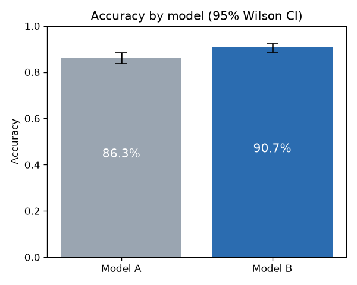
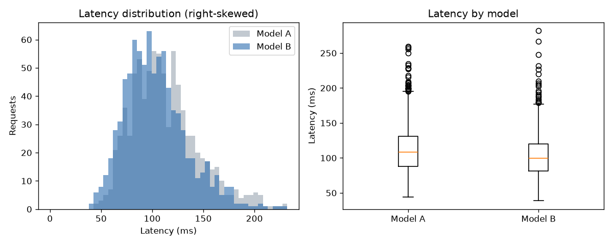
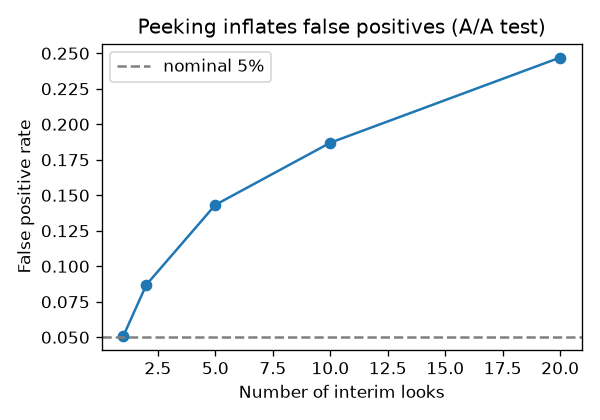

# A/B Testing Framework for ML Model Comparison

[](https://github.com/lukahere007/ml-model-ab-test-framework/actions/workflows/ci.yml)

[](LICENSE)

A new model (B) beats the production model (A) offline. Should it replace A? This project runs that decision as a properly designed A/B test on prediction logs: compute the sample size **before** collecting data, analyse **once**, report **effect sizes with confidence intervals** for accuracy and latency, and correct for testing two metrics. The statistics live in a small, unit-tested Python package (`src/abtest/`) that can be pointed at real logs. The logs here are **simulated**, with B built to be better (92% vs 85% accuracy, about 10% lower latency), so the results show the method recovering a known effect, not a finding about a real model.

## Results (simulated data, 1,700 requests, seed 42)

| Metric | Model A | Model B | B − A (95% CI) | Test | p (Holm-adjusted) |
|---|---|---|---|---|---|
| Accuracy | 86.3% | 90.7% | **+4.4 pp** (+1.4 to +7.5) | two-proportion z (= chi-square) | 0.004 |
| Mean latency | 113.6 ms | 104.1 ms | **−9.5 ms** (−12.7 to −6.3) | Welch t | < 0.001 |
| Median latency | 108.6 ms | 99.5 ms | **−9.0 ms** (−12.7 to −5.7) | bootstrap CI; Mann-Whitney | < 0.001 |

- **Design first.** Detecting an accuracy gain from 85% to 90% with 80% power at α = 0.025 per metric (two metrics, family-wise 0.05) needs **824 requests per model**. The test was planned at 1,700 requests, and the 838 / 862 split passed a sample-ratio-mismatch check (p = 0.56).
- **B is more accurate, by an uncertain amount.** The observed gain (+4.4 pp) is smaller than the 7 pp built into the simulation. The confidence interval still covers the truth, which is why it is reported rather than the point estimate alone.
- **B is faster, moderately.** Latency is right-skewed (skewness ≈ 1), so both the mean (Welch) and the median (bootstrap, Mann-Whitney) are compared. A random B request is faster than a random A request 58% of the time.
- **Peeking breaks the error rate.** In simulated A/A tests, stopping at the first p < 0.05 over 10 interim looks gave a **19%** false positive rate instead of 5% (25% with 20 looks).







## Method

| Step | Choice | Why |
|---|---|---|
| Sample size | Cohen's h / arcsine formula (`sample_size_two_proportions`) | Fixed before the data, from the smallest effect worth detecting. Matches R's `pwr::pwr.2p.test` (checked in the tests). |
| Randomisation check | Chi-square goodness of fit on group sizes (`srm_check`) | A sample ratio mismatch means broken routing or logging. |
| Accuracy | Pooled two-proportion z-test + Newcombe (Wilson) CI + Cohen's h (`compare_proportions`) | Equivalent to the chi-square test on the 2×2 table, but also reports how big the difference is. |
| Latency | Welch t-test + CI on the mean, bootstrap CI on the median, Mann-Whitney U + P(B faster) (`compare_continuous`) | Latency is skewed and variances differ, so Student's t is not the default. |
| Two metrics | Holm correction (`holm`) | Keeps the family-wise false positive rate at 5%. |
| Peeking | A/A simulation (`peeking_false_positive_rate`) | Shows why the analysis is run once, at the planned sample size. |

Power is treated as a **design** quantity. "Observed power" computed from the effect seen in the data is not reported, because it is just a transformation of the p-value.

## Repository layout

```
├── data/ab_model_predictions.csv    # simulated prediction log (written by the notebook)
├── notebooks/
│   └── ab_model_ab_test_report.ipynb  # the full analysis, start here
├── plots/                           # figures written by the notebook
├── src/abtest/                      # reusable, tested statistics
│   ├── design.py                    # Cohen's h, power, sample size
│   ├── analysis.py                  # proportions, continuous metrics, Holm, SRM check
│   └── simulate.py                  # synthetic logs and the peeking simulation
├── tests/                           # pytest unit tests (incl. checks against R pwr and Newcombe 1998)
└── .github/workflows/ci.yml         # runs tests + executes the notebook on every push
```

## Run it

```bash
git clone https://github.com/lukahere007/ml-model-ab-test-framework.git
cd ml-model-ab-test-framework
python -m venv .venv && source .venv/bin/activate   # Windows: .venv\Scripts\activate
pip install -r requirements.txt

pytest                      # unit tests
jupyter lab notebooks/      # open ab_model_ab_test_report.ipynb
```

Using it on your own logs:

```python
from abtest import compare_proportions, compare_continuous, holm

acc = compare_proportions(successes_a, n_a, successes_b, n_b)
lat = compare_continuous(latency_a, latency_b)
holm([acc.p_value, lat.welch_p])
```

## Limitations

- **Simulated data.** The numbers above demonstrate the procedure, not the performance of any real model.
- **Accuracy as the headline metric** only makes sense because the simulated classes are balanced. For imbalanced problems, compare precision/recall or a cost-weighted metric instead.
- **Requests are treated as independent.** In real traffic the same user sends many requests, so randomise and analyse by user (or use cluster-robust standard errors), otherwise the intervals are too narrow.
- **No tail-latency test.** Production decisions usually also look at p95/p99 latency, error rates and stability over time.
- **Fixed-horizon design only.** For monitoring a running test, use a sequential method (e.g. O'Brien-Fleming boundaries) rather than repeated fixed-horizon tests.

## Related

- [a-b-test-power](https://github.com/lukahere007/a-b-test-power): the R companion project on power and sample size for A/B tests (`pwr`, Cohen's h), including a Monte Carlo check of the power formula used here.

## Author

Luke Wamalwa ([GitHub](https://github.com/lukahere007))

## License

MIT
